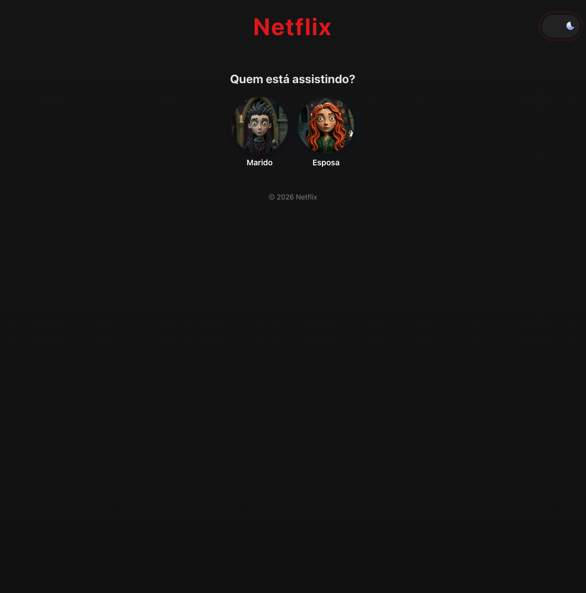

# 🎬 Netflix — Quem está assistindo?

Clone da tela de seleção de perfis da Netflix, com alternância entre tema claro e escuro. Feito com HTML, CSS e JavaScript durante a Imersão Alura de Front-end com IA.

## 📸 Preview

## ✨ Funcionalidades

- Tela de seleção de perfis ("Quem está assistindo?")
- Botão para alternar entre tema claro e escuro
- Página de catálogo

## 🛠️ Tecnologias

- HTML
- CSS
- JavaScript

## 👩‍💻 Autora

Feito por **Letycia Oliveira** — [GitHub](https://github.com/letyciaoliveirag)

# Sobre este projeto

Foi o meu segundo projeto de front-end e o que me fez me apaixonar por programação.
